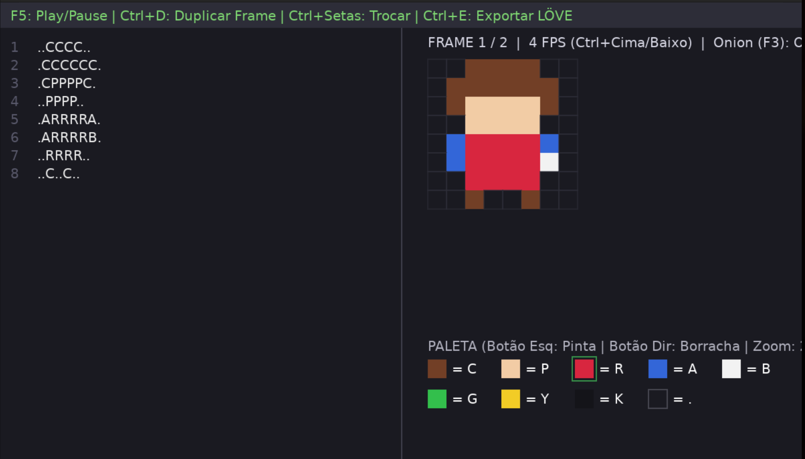
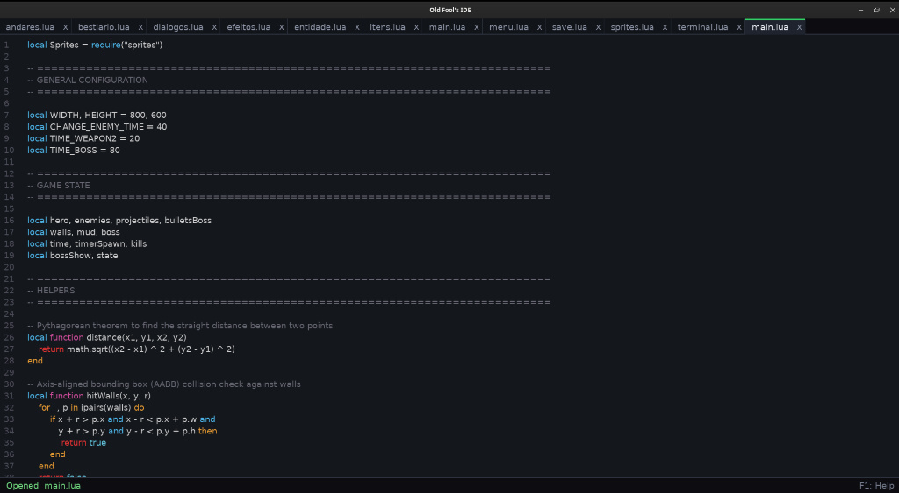

# ⚔️ Survivor Stage Prototype


A **single-stage Survivor-style game prototype** built completely from scratch using **Lua** and **LÖVE2D**.

The current goal is simple: nail the core loop, combat feel, enemy waves, and boss fight in **one solid, playable stage**. If this prototype clicks and plays well, the plan is to expand it into a **full game**!

---

## 🧠 Solo Dev & The Unexpected Math

I am coding everything on my own — from the game loop and collision systems to the custom tools used to build it.

One of the biggest surprises of this journey so far? **I never imagined making a simple 2D survivor game would require this much math!** Just to get one stage running, I had to wrestle with:
* **Pythagorean Theorem** for auto-aim targeting and circle-to-circle hit detection.
* **Vector Normalization (`0.7071`)** so moving diagonally doesn't make the hero faster than moving straight.
* **Trigonometry (`sin` & `cos`)** to make the secondary weapon orbs smoothly orbit around the player.
* **AABB (Axis-Aligned Bounding Box)** math to keep the hero, slimes, and projectiles colliding properly with dungeon walls and mud pits.

---

## 🛠️ Built With My Own Custom Tools

Instead of relying on standard off-the-shelf software, this project is being forged inside a **100% Lua/LÖVE2D custom ecosystem** I built myself:

### 🎨 CODEPIXELCREATOR *(Coming Soon!)*
All pixel-art sprites and tiles in this game were created using **CODEPIXELCREATOR**, a code-driven pixel art and animation tool I'm developing (with live text-to-pixel grid preview, frame animation, onion skinning, and direct LÖVE export). It will be released soon!



### 💻 Old Fool's IDE
Every single line of code in this project was written inside **Old Fool's IDE** — a lightweight, multi-tab code editor I built from scratch using Lua and LÖVE2D.



---

## 🎮 Current Features (Stage 1)

* **Auto-Aim Wand & Orbiting Orbs:** Automatic targeting for the primary weapon plus an unlockable orbiting secondary weapon.
* **Dynamic Waves & Boss Fight:** Slimes early on, flying bats (that ignore walls and mud) as time progresses, culminating in a boss encounter.
* **Environmental Hazards:** Solid dungeon walls and mud areas that slow down grounded entities.
* **100% Procedural Pixel Art:** Crisp `nearest`-filtered sprites and repeating tiles generated straight from code.


---

## 🚀 How to Run

1. Install [LÖVE2D](https://love2d.org/).
2. Clone this repository:
   ```bash
   git clone [https://github.com/YOUR-USERNAME/YOUR-REPO-NAME.git](https://github.com/YOUR-USERNAME/YOUR-REPO-NAME.git)
   cd YOUR-REPO-NAME
